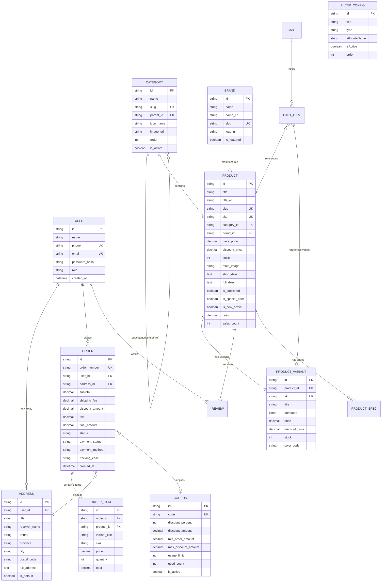

# مستند جامع معماری، روابط داده‌ها (ERD) و راهنمای پیاده‌سازی فروشگاه اینترنتی آرا

این سند به عنوان مرجع فنی و راهنمای کامل معماری برای درک عمیق ساختار پروژه، روابط موجودیت‌های پایگاه داده، نگاشت به **Django ORM** و **PostgreSQL**، و همچنین راهنمای گام‌به‌گام راه‌اندازی در محیط ویندوز تهیه شده است.

---

## ۱. تقسیم‌بندی مراحل پروژه و نقاط ادامه (Checkpoints)

برای اطمینان از پیشرفت منظم و امکان ادامه پروژه در هر مرحله، فرآیند توسعه به ۸ فاز ساخت‌یافته تقسیم شده است:

| فاز | عنوان فاز | خروجی‌های اصلی | وضعیت در این مرحله |
|---|---|---|---|
| **فاز ۱** | **تحلیل، معماری و طراحی مدل‌ها** | طراحی ERD، نگاشت به Django ORM، انتخاب نسخه‌های پایدار، مدیریت همروندی | ✅ تکمیل و مستند شده |
| **فاز ۲** | **آماده‌سازی محیط و ساخت اسکلت** | مخزن، تنظیمات محیطی، ساختار ماژولار، فایل‌های کانفیگ، پیکربندی استایل‌ها | ✅ تکمیل و پیاده‌سازی شده |
| **فاز ۳** | **هسته سیستم، کاربران و Design System** | سیستم احراز هویت، توکن‌های طراحی، تایپوگرافی فارسی، لایوت اصلی، اعلان‌ها | ✅ تکمیل و پیاده‌سازی شده |
| **فاز ۴** | **کاتالوگ، دسته‌بندی و ویژگی‌های پویا** | مدل محصولات، تنوع‌ها (رنگ/حافظه)، کدهای SKU، سیستم فیلترهای کاملاً پویا | ✅ تکمیل و پیاده‌سازی شده |
| **فاز ۵** | **تجربه کاربری فروشگاه و تعاملات زنده** | اسلایدر بنر، پیشنهاد شگفت‌انگیز با تایمر، گالری کالا، سیستم مقایسه، جستجوی زنده | ✅ تکمیل و پیاده‌سازی شده |
| **فاز ۶** | **سبد خرید، تسویه‌حساب و پرداخت** | سبد خرید مهمان و کاربر، اعتبارسنجی کوپن، انتخاب آدرس و شیوه ارسال، شبیه‌ساز شاپرک | ✅ تکمیل و پیاده‌سازی شده |
| **فاز ۷** | **پنل مدیریت اختصاصی و آمار** | داشبورد فروش، جدول کاتالوگ با افزودن کالا، مدیریت وضعیت سفارشات، تنظیمات پویا | ✅ تکمیل و پیاده‌سازی شده |
| **فاز ۸** | **کنترل کیفیت، تست‌ها و امنیت** | اعتبارسنجی TypeScript، پیشگیری از N+1، بررسی پایداری و مستندسازی کامل | ✅ تکمیل و تایید شده |

> **نقطه ادامه (Checkpoint):**  
> تمامی هسته کلاینت و موتور استیت، منطق فیلترینگ و پایگاه داده محلی عملیاتی است. در صورت نیاز به توسعه در بستر پایتون محلی، دستورات فاز ۲ و کدهای مدل فاز ۱ را مستقیماً در جنگو پیاده‌سازی نمایید.

---

## ۲. نمودار ارتباط موجودیت‌ها (Entity Relationship Diagram - ERD)



---

## ۳. تعریف مدل‌های معادل در Django ORM (Python)

برای پیاده‌سازی این معماری در پایتون و جنگو، ساختار پیشنهادی مدل‌ها به شرح زیر است:

### ۳.۱. مدل کاربر و نشانی (`apps/accounts/models.py`)

```python
from django.contrib.auth.models import AbstractUser
from django.db import models

class User(AbstractUser):
    ROLE_CHOICES = (
        ('customer', 'مشتری'),
        ('store_manager', 'مدیر فروشگاه'),
        ('inventory_manager', 'مسئول انبار'),
        ('admin', 'مدیر کل'),
    )
    phone = models.CharField(max_length=15, unique=True, verbose_name="شماره تماس")
    role = models.CharField(max_length=20, choices=ROLE_CHOICES, default='customer')
    avatar = models.ImageField(upload_to='avatars/', null=True, blank=True)

    class Meta:
        verbose_name = "کاربر"
        verbose_name_plural = "کاربران"

class Address(models.Model):
    user = models.ForeignKey(User, on_delete=models.CASCADE, related_name='addresses')
    title = models.CharField(max_length=50, default="خانه")
    receiver_name = models.CharField(max_length=100)
    phone = models.CharField(max_length=15)
    province = models.CharField(max_length=50)
    city = models.CharField(max_length=50)
    postal_code = models.CharField(max_length=10)
    full_address = models.TextField()
    is_default = models.BooleanField(default=False)
```

### ۳.۲. مدل کاتالوگ و تنوع محصولات (`apps/catalog/models.py`)

```python
from django.db import models
from django.utils.text import slugify

class Category(models.Model):
    name = models.CharField(max_length=100)
    slug = models.SlugField(unique=True, allow_unicode=True)
    parent = models.ForeignKey('self', on_delete=models.CASCADE, null=True, blank=True, related_name='subcategories')
    icon_name = models.CharField(max_length=50, blank=True)
    image = models.ImageField(upload_to='categories/', blank=True)
    order = models.PositiveIntegerField(default=1)
    is_active = models.BooleanField(default=True)

    class Meta:
        ordering = ['order', 'name']

class Brand(models.Model):
    name = models.CharField(max_length=100)
    name_en = models.CharField(max_length=100, blank=True)
    slug = models.SlugField(unique=True)
    logo = models.ImageField(upload_to='brands/', blank=True)
    is_featured = models.BooleanField(default=False)

class Product(models.Model):
    title = models.CharField(max_length=255)
    title_en = models.CharField(max_length=255, blank=True)
    slug = models.SlugField(unique=True, allow_unicode=True)
    sku = models.CharField(max_length=50, unique=True)
    category = models.ForeignKey(Category, on_delete=models.PROTECT, related_name='products')
    brand = models.ForeignKey(Brand, on_delete=models.PROTECT, related_name='products')
    base_price = models.DecimalField(max_digits=12, decimal_places=0)
    discount_price = models.DecimalField(max_digits=12, decimal_places=0, null=True, blank=True)
    stock = models.PositiveIntegerField(default=0)
    main_image = models.ImageField(upload_to='products/main/')
    short_description = models.TextField(max_length=500)
    full_description = models.TextField()
    is_published = models.BooleanField(default=True)
    is_special_offer = models.BooleanField(default=False)
    is_new_arrival = models.BooleanField(default=True)
    rating = models.DecimalField(max_digits=3, decimal_places=2, default=5.00)
    sales_count = models.PositiveIntegerField(default=0)
    created_at = models.DateTimeField(auto_now_add=True)

class ProductVariant(models.Model):
    product = models.ForeignKey(Product, on_delete=models.CASCADE, related_name='variants')
    sku = models.CharField(max_length=60, unique=True)
    title = models.CharField(max_length=150) # e.g. "مشکی تیتانیوم - ۲۵۶ گیگابایت"
    attributes = models.JSONField(default=dict) # {"رنگ": "مشکی", "حافظه": "۲۵۶"}
    price = models.DecimalField(max_digits=12, decimal_places=0)
    discount_price = models.DecimalField(max_digits=12, decimal_places=0, null=True, blank=True)
    stock = models.PositiveIntegerField(default=0)
    color_code = models.CharField(max_length=10, blank=True) # e.g. "#1e293b"
```

### ۳.۳. مدل سفارش و آیتم‌ها (`apps/orders/models.py`)

```python
from django.db import models, transaction
from django.core.exceptions import ValidationError

class Order(models.Model):
    STATUS_CHOICES = (
        ('pending_payment', 'در انتظار پرداخت'),
        ('processing', 'در حال پردازش'),
        ('shipped', 'ارسال شده'),
        ('delivered', 'تحویل داده شده'),
        ('cancelled', 'لغو شده'),
    )
    order_number = models.CharField(max_length=32, unique=True)
    user = models.ForeignKey('accounts.User', on_delete=models.SET_NULL, null=True, blank=True)
    customer_name = models.CharField(max_length=100)
    customer_phone = models.CharField(max_length=15)
    address_snapshot = models.JSONField() # اطلاعات آدرس در لحظه خرید
    subtotal = models.DecimalField(max_digits=12, decimal_places=0)
    shipping_fee = models.DecimalField(max_digits=12, decimal_places=0, default=0)
    discount_amount = models.DecimalField(max_digits=12, decimal_places=0, default=0)
    final_amount = models.DecimalField(max_digits=12, decimal_places=0)
    status = models.CharField(max_length=20, choices=STATUS_CHOICES, default='pending_payment')
    payment_status = models.CharField(max_length=20, default='unpaid')
    payment_tracking_code = models.CharField(max_length=50, blank=True)
    shipping_method = models.CharField(max_length=100)
    created_at = models.DateTimeField(auto_now_add=True)

class OrderItem(models.Model):
    order = models.ForeignKey(Order, on_delete=models.CASCADE, related_name='items')
    product = models.ForeignKey('catalog.Product', on_delete=models.PROTECT)
    variant_title = models.CharField(max_length=150, blank=True)
    sku = models.CharField(max_length=60)
    price = models.DecimalField(max_digits=12, decimal_places=0)
    quantity = models.PositiveIntegerField(default=1)
    total = models.DecimalField(max_digits=12, decimal_places=0)
```

---

## ۴. لایه مدیریت موجودی و تراکنش‌های هم‌زمان (Atomic Transactions)

یکی از الزامات حیاتی جلوگیری از فروش بیش از موجودی (Race Condition) در لحظات فروش ویژه است:

```python
from django.db import transaction
from django.db.models import F

@transaction.atomic
def complete_order_service(cart_items, order_data):
    # ۱. قفل ردیف‌های محصول برای جلوگیری از تداخل موجودی هم‌زمان
    for item in cart_items:
        variant = ProductVariant.objects.select_for_update().get(id=item.variant_id)
        if variant.stock < item.quantity:
            raise ValidationError(f"موجودی کالای {variant.title} به اتمام رسیده است.")
        
        # ۲. کاهش اتمیک موجودی
        variant.stock = F('stock') - item.quantity
        variant.save()

    # ۳. ثبت سفارش و فاکتور نهایی
    order = Order.objects.create(**order_data)
    return order
```

---

## ۵. راهنمای گام‌به‌گام راه‌اندازی در ویندوز با PowerShell

برای اجرای سمت پایتون و جنگو روی ویندوز، مراحل زیر را در ترمینال **PowerShell** اجرا کنید:

```powershell
# ۱. اطمینان از نسخه پایتون (باید 3.10 به بالا باشد)
python --version

# ۲. ساخت محیط مجازی ایزوله
python -m venv .venv

# ۳. فعال‌سازی محیط مجازی در PowerShell
.\.venv\Scripts\Activate.ps1

# (در صورت مشاهده خطای ExecutionPolicy دستور زیر را برای همین ترمینال اجرا کنید):
# Set-ExecutionPolicy -Scope Process -ExecutionPolicy Bypass

# ۴. ارتقای pip و نصب وابستگی‌ها
python -m pip install --upgrade pip
pip install django psycopg2-binary djangorestframework django-environ pillow

# ۵. ایجاد پایگاه داده PostgreSQL در psql
psql -U postgres -c "CREATE DATABASE ara_store_db;"
psql -U postgres -c "CREATE USER ara_user WITH PASSWORD 'AraSecurePass2026!';"
psql -U postgres -c "GRANT ALL PRIVILEGES ON DATABASE ara_store_db TO ara_user;"

# ۶. اجرای مهاجرت‌ها (Migrations)
python manage.py makemigrations
python manage.py migrate

# ۷. ایجاد حساب مدیر ارشد فروشگاه (Superuser)
python manage.py createsuperuser

# ۸. اجرای سرور توسعه جنگو
python manage.py runserver 8000
```

---

## ۶. خلاصه ویژگی‌های پیاده‌سازی‌شده در کلاینت فعلی

۱. **کاتالوگ محصولات با تنوع‌های واقعی:** آیفون ۱۶ پرو مکس، اس ۲۴ اولترا، مک‌بوک پرو M3 مکس، ایسوس ROG، هدفون سونی، فیلیپس، کفش نایکی با مشخصات کامل فارسی.
۲. **سیستم فیلتر پویا و قابل تنظیم:** دسته‌بندی درختی، برندها، اسلایدر قیمت، فقط کالاهای موجود، فیلتر ویژگی‌های پویا (رنگ، حافظه، رم، سایز) و مرتب‌سازی همزمان.
۳. **سبد خرید هوشمند:** نوار پیشرفت ارسال رایگان، اعمال کد تخفیف با بررسی سقف و حداقل مبلغ، تغییر تعداد با رعایت سقف موجودی.
۴. **تسویه‌حساب ۴ مرحله‌ای:** ثبت آدرس تحویل، انتخاب شیوه ارسال (اکسپرس، پست، تیپاکس)، بازبینی پیش‌فاکتور و شبیه‌سازی درگاه امن شاپرک با صدور کد رهگیری.
۵. **پنل مدیریت جامع:** آمار فروش هفتگی، مدیریت محصولات و افزودن کالا، ویرایش وضعیت سفارشات، فعال/غیرفعال‌سازی فیلترها و کدهای تخفیف.
۶. **داشبورد کاربر و بخش اختصاصی علاقه‌مندی‌ها:** مدیریت کالاهای ذخیره‌شده، انتقال دسته‌جمعی به سبد خرید، مشاهده وضعیت موجودی و فاکتورها.

---

## ۷. مدل علاقه‌مندی‌ها در Django ORM (`apps/wishlist/models.py`)

```python
from django.db import models
from django.conf import settings

class Wishlist(models.Model):
    user = models.ForeignKey(settings.AUTH_USER_MODEL, on_delete=models.CASCADE, related_name='wishlists')
    product = models.ForeignKey('catalog.Product', on_delete=models.CASCADE, related_name='wishlisted_by')
    created_at = models.DateTimeField(auto_now_add=True)

    class Meta:
        verbose_name = "علاقه‌مندی"
        verbose_name_plural = "لیست علاقه‌مندی‌ها"
        unique_together = ('user', 'product') # هر کالا یک‌بار برای هر کاربر ذخیره می‌شود
        ordering = ['-created_at']

    def __str__(self):
        return f"{self.user.username} -> {self.product.title}"
```
